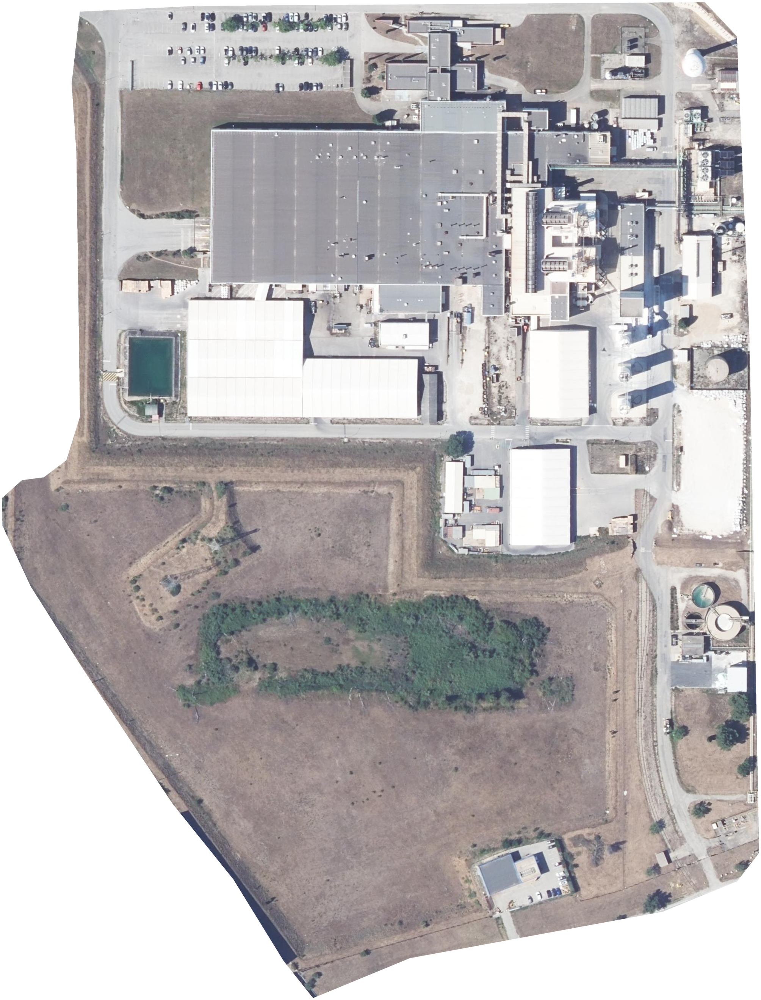

# Vue aérienne OCC — L’Ardoise

Image réelle IGN BD ORTHO, prise de vue 2024, résolution de 20 cm/pixel. Dimensions : 2008 × 2636 pixels. Fond transparent hors du contour fourni. Aucun détail n’a été inventé ou recréé.

## Utilisation immédiate

Ouvrir `index.html` après décompression, en conservant les fichiers et dossiers à côté. Aucun accès à Internet n’est nécessaire. La molette ou le pincement permettent de zoomer ; le glissement déplace la vue. Le bouton « Détail natif » affiche les pixels de l’image à leur taille native sur l’écran.

Le PNG constitue le fichier maître. Le WebP contient exactement les mêmes pixels avec une compression sans perte plus compacte. Pour une insertion simple :

```html

```

Conserver à proximité de la vue la mention : **Source : IGN — BD ORTHO® — prise de vue 2024 — Licence Ouverte Etalab 2.0**.

## Zoom progressif dans l’application

Le dossier `occ_files` et le descripteur `occ.dzi` constituent une pyramide Deep Zoom standard. Toutes les tuiles sont des PNG sans perte avec transparence. Le niveau final conserve la résolution réelle ; les niveaux inférieurs rendent la navigation plus rapide.

Le composant `occ-orthophoto-viewer.js` est autonome et sans dépendance externe. Exemple :

```html
<div id="plan" style="position:relative;height:70vh;overflow:hidden;background:#101a16;touch-action:none"></div>
<script src="occ-config.js"></script>
<script src="occ-orthophoto-viewer.js"></script>
<script>
const plan = new OCCOrthophotoViewer(document.getElementById('plan'), OCC_ORTHOPHOTO_CONFIG);
plan.fit();
// plan.zoomBy(1.5), plan.nativeDetail(), plan.screenToImage(x, y)
// plan.imageToScreen(x, y), plan.setOverlayDrawer((ctx, state) => { ... })
</script>
```

À l’échelle native, chaque pixel représente 0,20 mètre. Un zoom au-delà agrandit ces pixels sans révéler de nouveaux détails.

## Superposer la distribution électrique

Les repères et liaisons doivent être dessinés dans une couche vectorielle indépendante, pour conserver leur netteté au zoom. Le composant applique la même transformation aux repères et à l’image. L’origine de l’image est son coin supérieur gauche ; x augmente vers la droite, y vers le bas. Les repères peuvent être stockés en x/y natifs, ou en coordonnées normalisées entre 0 et 1.

`setOverlayDrawer` reçoit un contexte Canvas dont les coordonnées sont déjà celles de l’image. `state.scale` permet de garder les libellés et les épaisseurs lisibles à l’écran. Cette livraison n’inclut aucun emplacement d’armoire ou tracé électrique supposé.

Pour géoréférencer la vue, le fichier PGW et le PRJ utilisent RGF93 / Lambert-93 (EPSG:2154). La conversion d’un centre de pixel (x, y) est :

- Est = 835972.100 + 0,20 × x
- Nord = 6335664.500 − 0,20 × y

`emprise.geojson` contient le contour en longitude/latitude (WGS84). Ce contour est indicatif, repris de l’image de référence ; il ne constitue pas une limite cadastrale certifiée. Les détails de la provenance et du traitement figurent dans `metadata.json`.
